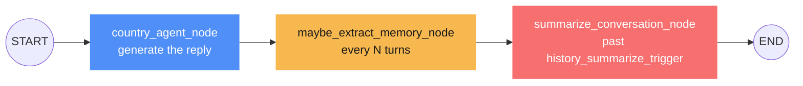
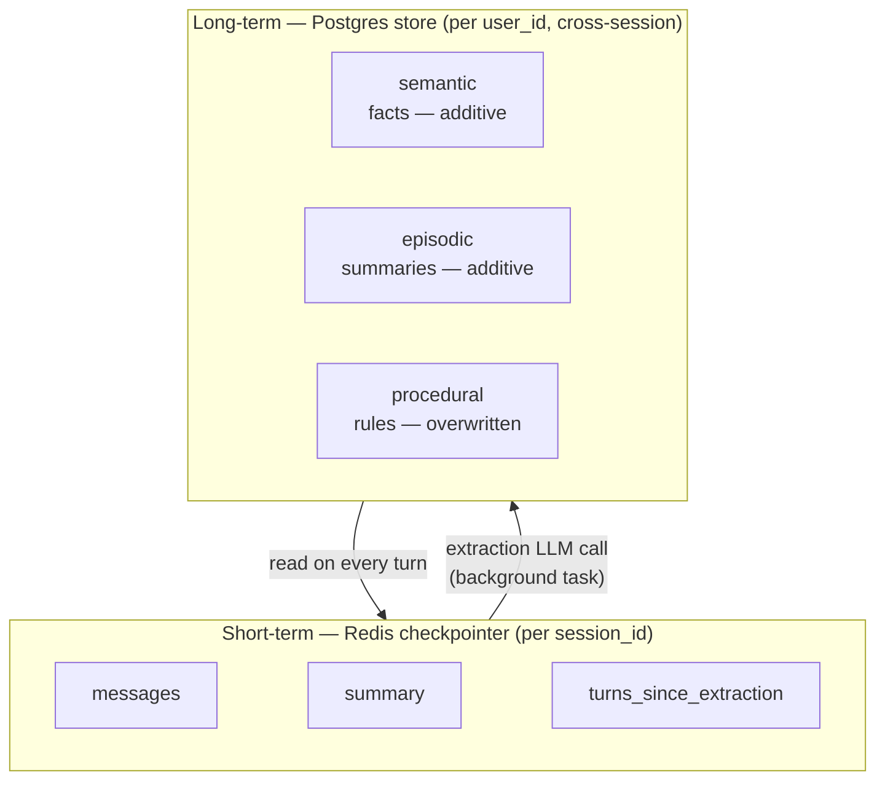
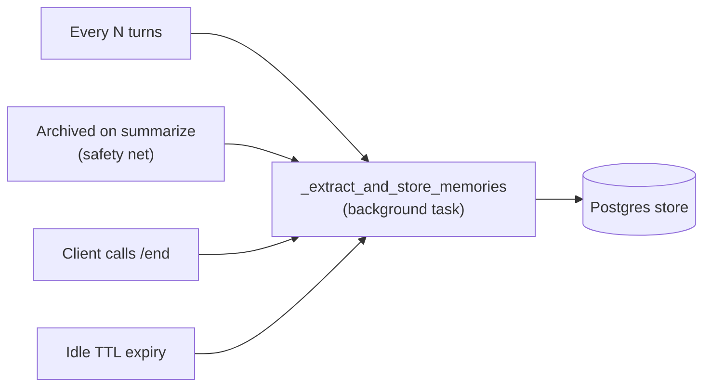
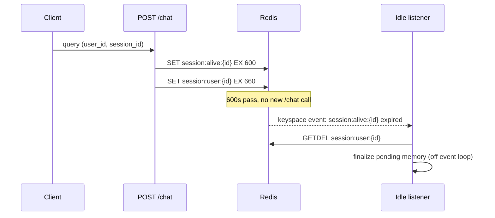

# Companion AI

A LangGraph-based conversational agent that acts as a country-focused guide, with
persistent long-term memory per user across sessions.

## Stack

- **FastAPI** — HTTP API (`backend/api/server.py`)
- **LangGraph** — conversation graph / orchestration (`backend/graph`, `backend/agents`)
- **Redis** — short-term memory: per-session checkpointed conversation state
- **PostgreSQL** (+ OpenAI embeddings) — long-term memory: durable, cross-session facts about each user
- **OpenAI** — chat model and structured-output extraction

## API

### `POST /chat`

```json
{
  "query": "What's the best time to visit Japan?",
  "session_id": "optional - omit to start a new session",
  "user_id": "optional - omit for an anonymous, non-persisted conversation",
  "country": "Japan (required to start a new session)"
}
```

Returns `{"session_id", "user_id", "response"}`. Reuse `session_id` to continue a conversation.

### `POST /chat/{session_id}/end?user_id=...`

Call when a conversation is over. Flushes any pending long-term memory immediately.
Optional — the idle listener (below) does the same thing automatically if skipped.

## Conversation flow



- **`country_agent_node`** — the only node that produces the user-visible reply. Prompt = persona + running `summary` + long-term memory for `user_id`.
- **`maybe_extract_memory_node`** — counts turns since the last extraction; at `memory_extraction_every_n_turns` (default 4) it extracts and resets the counter.
- **`summarize_conversation_node`** — past `history_summarize_trigger` messages (default 10), archives everything except the last `history_keep_last_n` (default 6) into `summary` and deletes them from the checkpoint via `RemoveMessage`.

## Memory architecture



Short-term state never crosses sessions — a new `session_id` starts empty even for
a returning `user_id`. Long-term memory is how a *new* session knows what the user
said in a *previous* one.

### Extraction triggers

Extraction always runs via `BackgroundTasks` — scheduled during the request,
executed *after* the response is already sent — never inline in `/chat`.



Triggers 1 and 2 can overlap and double-write facts — cheap, and preferred over
losing them. Triggers 3 and 4 exist for short sessions that never reach 1 or 2.

### Idle-session backstop



Requires Redis `notify-keyspace-events` to include `Ex` — the app sets this itself
on startup. If `CONFIG SET` is blocked (some managed Redis), this fails soft: a
warning is logged, and the periodic/explicit-end triggers still cover memory.

## Configuration

All settings load from `.env` (see `backend/config/settings.py`):

| Setting | Default | Purpose |
| --- | --- | --- |
| `openai_api_key` | — | required |
| `chat_model` | `gpt-4o-mini` | model for responses and extraction |
| `database_url` | — | Postgres connection string (long-term store) |
| `redis_url` | — | Redis connection string (checkpointer + session markers) |
| `history_summarize_trigger` | `10` | message count that triggers summarization |
| `history_keep_last_n` | `6` | messages kept verbatim when summarizing |
| `memory_extraction_every_n_turns` | `4` | periodic long-term memory extraction cadence |
| `session_idle_seconds` | `600` | idle time before the Redis-expiry backstop fires |

## Running locally

```bash
uv run python -m backend.api.server
```

Requires a reachable Redis and Postgres (connection strings in `.env`). Runs
checkpointer/store migrations on startup, then serves on `127.0.0.1:8001`.

Note: `main.py` at the repo root is a separate, minimal FastAPI app — not the real entrypoint.
